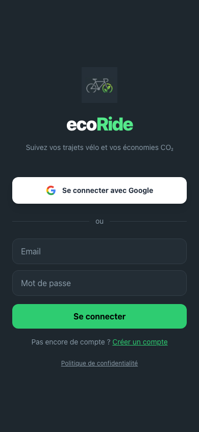
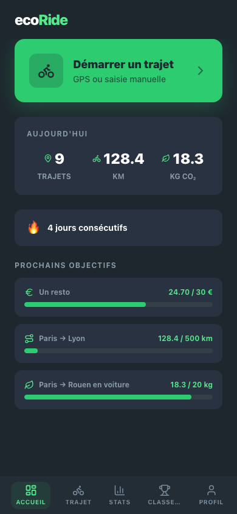
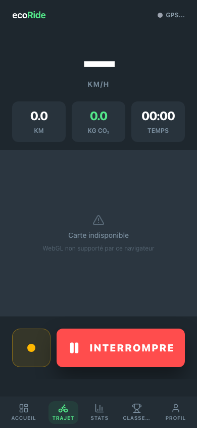
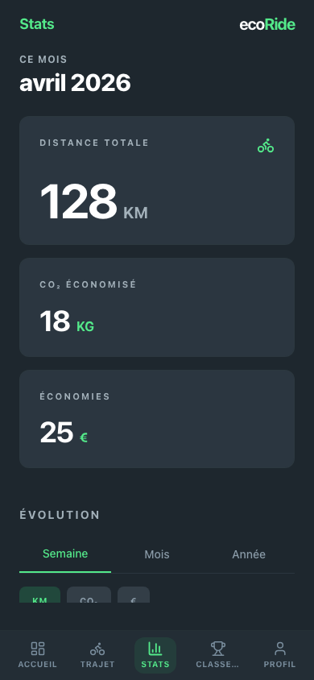
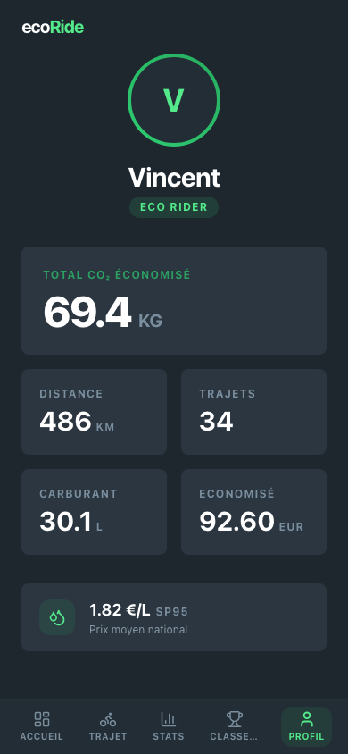

# ecoRide

PWA mobile-first de suivi de trajets vélo avec calcul d'économies CO₂, argent et essence.

## Aperçu

<p align="center">
  
  
  
  
  
</p>

## Fonctionnalités

- **GPS tracking** : watchPosition haute précision, haversine, wake lock, indicateur qualité GPS
- **Saisie manuelle** : distance + durée optionnelle pour les trajets sans GPS
- **Calculs** : CO₂ économisé (facteur ADEME 2.31 kg/L), argent, carburant
- **Prix carburant** : API officielle data.economie.gouv.fr, géolocalisé si GPS disponible
- **Gamification** : 46 badges (6 catégories) avec unlock/revocation automatique, streaks
- **Classement** : leaderboard multi-utilisateur avec dense ranking et opt-out
- **Notifications push** : badges débloqués, dépassements au classement, rappels quotidiens (heure et fuseau de l'utilisateur)
- **Offline** : file d'attente localStorage avec sync automatique au retour réseau
- **PWA** : installable, auto-update avec version polling toutes les 5 min
- **RGPD** : export de données, suppression de compte, politique de confidentialité

## Stack

- **Frontend** : React 19 + Vite + TailwindCSS v4 + PWA + Playwright
- **Backend** : Bun + Hono + Drizzle ORM
- **Auth** : Better Auth (Google OAuth + email/password)
- **DB** : PostgreSQL
- **CI** : GitHub Actions (commitlint, lint/format, audit dépendances, build de l'image Docker de production, typecheck, vitest, bundle-size, coverage ≥70%, smoke tests Playwright, Lighthouse a11y)
- **Deploy** : Docker + auto-bump + Coolify

## Setup

```bash
# Prérequis : Bun, Docker

# 1. Installer les dépendances
bun install

# 2. Copier les variables d'environnement
cp .env.example .env
# → Remplir GOOGLE_CLIENT_ID, GOOGLE_CLIENT_SECRET, BETTER_AUTH_SECRET

# 3. Lancer PostgreSQL
docker compose up -d

# 4. Initialiser le schéma local uniquement
bun run db:push:local

# 5. Lancer le dev
bun run dev
```

Le client tourne sur http://localhost:5173, le serveur sur http://localhost:3000.

## Structure

```
shared/     Types TypeScript partagés + contrats API
server/     API Hono + Drizzle schema + Better Auth
client/     React PWA + Tailwind + Playwright e2e
```

## Scripts

| Commande                           | Description                                       |
| ---------------------------------- | ------------------------------------------------- |
| `bun run dev`                      | Lance client + serveur en parallèle               |
| `bun run dev:client`               | Client seul (Vite :5173)                          |
| `bun run dev:server`               | Serveur seul (Hono :3000)                         |
| `bun run db:push:local`            | Applique le schéma Drizzle sur une DB locale vide |
| `bun run db:generate`              | Génère une migration Drizzle revue avant prod     |
| `bun run db:migrate`               | Applique les migrations SQL versionnées           |
| `bun run db:studio`                | Ouvre Drizzle Studio                              |
| `bun run typecheck`                | Vérifie les types dans tous les workspaces        |
| `cd client && bunx vitest run`     | Lance les tests unitaires                         |
| `cd client && npx playwright test` | Lance les smoke tests e2e                         |

## CI / CD

### Pipeline CI (sur chaque PR)

Jobs définis dans `.github/workflows/ci.yml` :

1. **commitlint** : conventional commits sur la PR (PR uniquement)
2. **Lint & format** : `bun run lint`, `bun run format:check`
3. **Audit dépendances** : `bun audit --audit-level=critical`
4. **Production image build** : `docker build` de l'image de production (l'image n'est pas démarrée)
5. **TypeScript check** : `bun run typecheck`
6. **Tests unitaires** : vitest client (`bunx vitest run`) et serveur (`bun run test:coverage`)
7. **Bundle size** : diff gzip vs base, budget +50 Ko, commentaire PR (PR uniquement)
8. **Coverage** : seuil combiné 70 %, commentaire PR
9. **Smoke tests Playwright** : build client + test chaque page sans crash
10. **Lighthouse CI** : seuil accessibilité (PR uniquement)

Toutes les installations de dépendances (CI et Dockerfile) utilisent `bun install --frozen-lockfile` :
`bun.lock` doit être commité avec tout changement de manifeste.

Seuls Lint & Format, Tests, TypeScript check et Smoke test sont des checks requis par la
protection de branche (réglage du dépôt, non versionné) ; les autres jobs remontent un
statut mais ne bloquent pas le merge aujourd'hui.

### Pipeline CD (sur merge dans main)

Le même `ci.yml` tourne aussi sur le push dans `main`. Le workflow séparé
`.github/workflows/auto-bump.yml` (déclenché sur chaque push sur `main`) enchaîne trois jobs :

1. **Bump** : lit le conventional commit (`feat:` → minor, `fix:`/`perf:`/`refactor:` → patch,
   `BREAKING CHANGE` → major ; un commit de merge GitHub est classé d'après le titre de la PR).
   Tout autre type (`chore:`, `docs:`…) donne `none` : pas de bump **et pas de déploiement**
   (les deux jobs suivants sont sautés)
2. **ci-gate** : attend la CI (`ci.yml`) du SHA exact à déployer et échoue si elle n'est pas `success`
3. **Deploy** : refuse de déployer si `main` ne pointe plus sur ce SHA, puis déclenche Coolify
   et attend la fin du déploiement
4. **Pré-backup obligatoire** : au démarrage en production, le conteneur déclenche un backup Coolify
   et attend un nouveau statut `success` avant de migrer (120 s max). Sans `COOLIFY_WEBHOOK_URL` et
   `COOLIFY_API_TOKEN`, sans backup planifié activé côté Coolify, ou si le backup échoue, le démarrage
   échoue avant la migration — voir `server/scripts/start-production.ts` et
   `server/src/lib/coolify-backup.ts`
5. **Schéma DB** : après le backup réussi, le conteneur applique uniquement les migrations SQL
   versionnées (`drizzle-kit migrate`) — jamais `push --force`
6. **Auto-update PWA** : l'app poll `/api/health` toutes les 5 min, purge le cache si version changée

Limites connues du déploiement : la requête Coolify ne porte pas le SHA, donc Coolify déploie la
tête de `main` au moment de l'appel (la vérification juste avant réduit la fenêtre sans la fermer).
Et GitHub ne garde qu'un run en attente par groupe de concurrence : lors de merges en rafale, un run
plus récent annule le run en attente ; si celui-ci devait déployer un `fix:`/`feat:` et que le suivant
est de type `none`, ce changement n'est pas déployé avant le prochain merge `fix:`/`feat:`
(pas de nouvelle tentative automatique).

## Deploiement

### Docker

```bash
# Build et lancer tous les services
docker compose up --build

# L'app est accessible sur http://localhost:3000
```

### Variables d'environnement (production)

| Variable               | Description                                                |
| ---------------------- | ---------------------------------------------------------- |
| `DATABASE_URL`         | Connexion PostgreSQL                                       |
| `BETTER_AUTH_SECRET`   | Secret auth (`openssl rand -hex 32`)                       |
| `BETTER_AUTH_URL`      | URL publique de l'app (ex: `https://mon-domaine.com`)      |
| `GOOGLE_CLIENT_ID`     | Client ID Google OAuth                                     |
| `GOOGLE_CLIENT_SECRET` | Client Secret Google OAuth                                 |
| `FRONTEND_URL`         | URL publique de l'app (même valeur que `BETTER_AUTH_URL`)  |
| `COOLIFY_WEBHOOK_URL`  | URL du webhook Coolify, requise au démarrage en production |
| `COOLIFY_API_TOKEN`    | Jeton API Coolify, requis au démarrage en production       |
| `VAPID_PUBLIC_KEY`     | Clé publique push (`bunx web-push generate-vapid-keys`)    |
| `VAPID_PRIVATE_KEY`    | Clé privée push                                            |
| `VAPID_SUBJECT`        | `mailto:votre-email@exemple.com`                           |

### Sécurité base de données en production

- Les déploiements production ne doivent jamais utiliser `drizzle-kit push` ou `--force`.
- Toute évolution de schéma passe par `bun run db:generate`, revue du SQL généré, puis application via `bun run db:migrate`.
- En production, le démarrage exige `COOLIFY_WEBHOOK_URL` et `COOLIFY_API_TOKEN` ainsi qu'un backup
  planifié activé côté Coolify pour la base. Si l'une des deux variables manque, si aucun backup activé
  n'existe, si le backup déclenché échoue ou si aucun nouveau backup ne réussit en 120 s, la migration
  n'est pas lancée et le démarrage de la nouvelle révision échoue
  (`server/scripts/start-production.ts`, `requireConfig: true`, `server/src/lib/coolify-backup.ts`).
